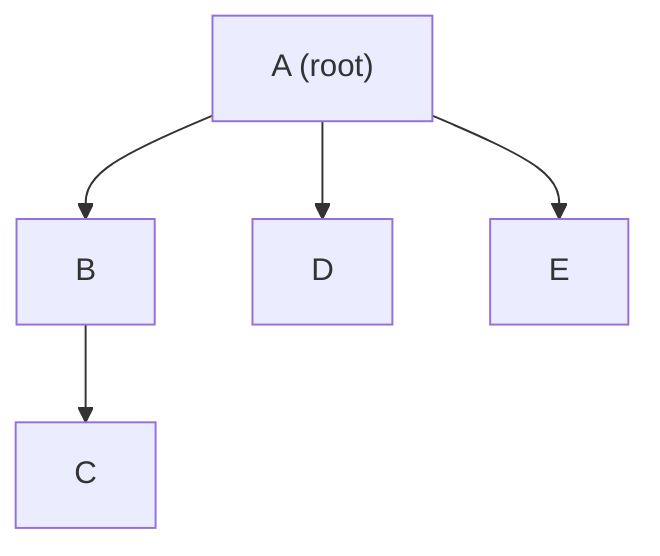
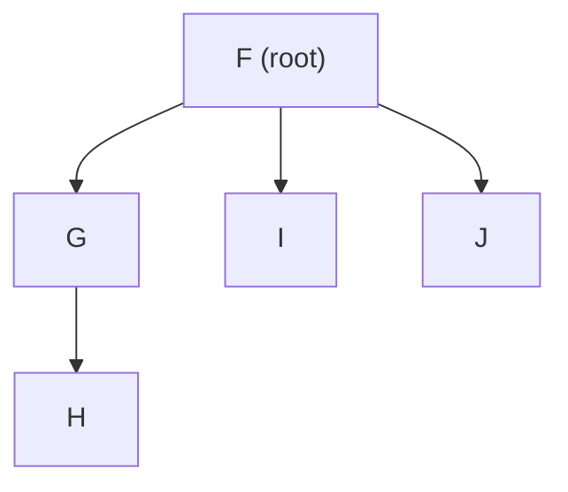
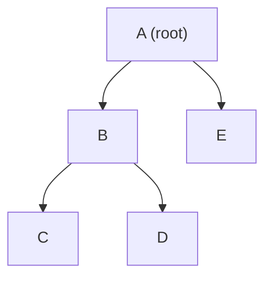
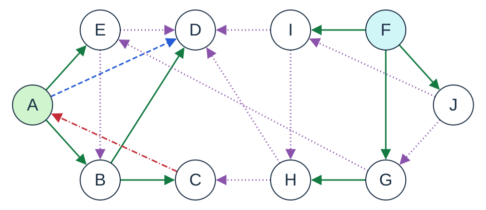
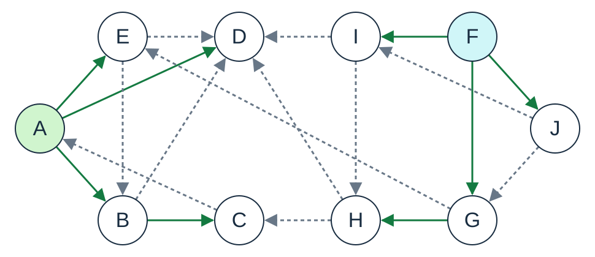

# Directed graph: breadth-first and depth-first traversals

## Purpose and prerequisites

Explore the exact directed graph, with ten vertices and nineteen arcs, from the
**"Example graph for DFS and BFS"** slide of Topic 6. It contains cycles, and
some of its vertices cannot be reached from A, although the underlying
undirected graph is connected. Compare **breadth-first search (BFS)** with
**depth-first search (DFS)**, and see how discovering vertices produces a tree
or a forest even though the original graph is not a tree.

You should already know generic collections, maps, sets, stacks and queues. DFS
uses an explicit LIFO stack that holds the vertices themselves, and BFS uses a
FIFO queue. There is no recursion, and no stack entry holds a neighbour
iterator. DFS marks a vertex when it pushes it onto the current path, whereas
BFS marks it when it enqueues it. The example needs only JDK 17: no external
libraries, downloads or other demo folders.

## Files and responsibilities

- `src/ds/Graph.java`: a small, unweighted, simple directed graph, stored as a
  sorted map of sorted neighbour sets.
- `src/ds/Traversals.java`: searches from a single source and forests covering
  the whole graph; each result holds the discovery order and the parent of each
  vertex.
- `src/app/ExampleGraph.java`: builds the exact graph from the theory slide.
- `src/app/Main.java`: compares four traversal results.
- `docs/theory-traversal-graph.svg`: the same topology and arrangement of nodes
  as on the slide.
- `tests/tests/ExampleChecks.java`: checks the contracts, cycles, reachability,
  parent edges, shortest hop counts and the independence of results.

## The graph


The diagram keeps the arrangement of nodes and the direction of the arcs from
the slide. A is highlighted in green and F in blue: they are the roots of the
two trees in the forest when the starting vertices and the neighbours are taken
in alphabetical order. Points where arcs cross are not vertices.

| Vertex | Outgoing neighbours, alphabetically |
| --- | --- |
| A | B, D, E |
| B | C, D |
| C | A |
| D | None |
| E | B, D |
| F | G, I, J |
| G | E, H |
| H | C, D |
| I | D, H |
| J | G, I |

Each arrow is one directed arc. For example, C -> A closes a cycle, and D can be
reached from A either directly or through B. G -> E, H -> C, H -> D and I -> D
connect the two regions in the direction shown, but they do not make F reachable
from A. No vertices or arcs have been added to the graph on the slide.

The vertices and their outgoing neighbours are processed in alphabetical order,
because `ExampleGraph.create()` passes `Comparator.naturalOrder()`.

## BFS: use a queue

1. Mark A and enqueue it.
2. Dequeue A, visit it, and enqueue the neighbours that are not yet marked: B, D
   and E.
3. Dequeue B and enqueue C. D is already marked, so it is not enqueued again.
4. Process D, E and C. E's neighbours B and D are already marked, and C's arc
   back to A also reaches a marked vertex.

The order is **A, B, D, E, C**. Marking vertices when they are enqueued avoids
repeating work when two arcs reach the same vertex. The parent entries are B=A,
D=A, E=A and C=B. Following them backwards rebuilds a path from the source. In a
single-source BFS, that path has the minimum number of arcs; it does not
minimise arbitrary weighted costs, which is the problem the Dijkstra example
solves.

## DFS: keep the current path on a stack

`Deque<V> path = new ArrayDeque<>();` provides the stack. `push` adds a vertex,
`peek` reads the top without removing it, and `pop` removes it. The entries are
just vertices, and the stack represents the path currently being explored.

1. Mark and visit the source, then push it.
2. Look at the top vertex with `peek`.
3. Find its first unvisited neighbour in alphabetical order. If there is one,
   mark and visit it, record its parent, and push **only that neighbour**.
4. If there are no unvisited neighbours left, pop the top to backtrack.
5. Repeat until the stack is empty.

The trace shows the stack **from bottom to top**, with the top on the right:

| Action | Stack afterwards | Visit order so far |
| --- | --- | --- |
| Mark, visit and push A | [A] | [A] |
| Peek A; discover and push B | [A, B] | [A, B] |
| Peek B; discover and push C | [A, B, C] | [A, B, C] |
| Peek C; A is marked, so pop C | [A, B] | [A, B, C] |
| Peek B; C is marked, discover and push D | [A, B, D] | [A, B, C, D] |
| Peek D; no neighbours, so pop D | [A, B] | [A, B, C, D] |
| Peek B; all neighbours marked, so pop B | [A] | [A, B, C, D] |
| Peek A; B and D marked, discover and push E | [A, E] | [A, B, C, D, E] |
| Peek E; B and D marked, so pop E | [A] | [A, B, C, D, E] |
| Peek A; all neighbours marked, so pop A | [] | [A, B, C, D, E] |

Each vertex is pushed once and its parent is recorded once. No vertex appears
twice on the stack, and no parent is ever provisional. The neighbours are
examined in their normal alphabetical order; there is no need to reverse it,
because only one neighbour is pushed at a time. `null` means that no unvisited
neighbour was found, and since the graph's contract forbids `null` vertices,
this sentinel cannot be confused with a real vertex.

The order is **A, B, C, D, E**. D has parent B, even though A also has a direct
arc to D: DFS does not guarantee shortest paths. This is the explicit-stack
approach used in class, and it produces the same discovery order and parent
forest as a recursive DFS that examines the neighbours in the same order.

## One source versus a complete forest

`breadthFirst(graph, source)` and `depthFirst(graph, source)` visit only the
vertices that can be reached from that source. From A, they visit A, B, C, D and
E.

`breadthFirstForest(graph)` and `depthFirstForest(graph)` go through all the
vertices and start a new search at each one that is still unmarked, reusing the
same set of marks. When the first search finishes, the next unmarked vertex is
F. The arcs from the second region into the first one lead to vertices that are
already marked.

| Traversal | Complete discovery order | Roots |
| --- | --- | --- |
| DFS forest | A, B, C, D, E, F, G, H, I, J | A, F |
| BFS forest | A, B, D, E, C, F, G, I, J, H | A, F |

These are the orders given in the theory presentation. In both forests, G, I and
J have parent F, and H has parent G. The parents in the first region are the
ones explained above; in particular, D has parent B in DFS and parent A in BFS.

A root has **no parent entry**, and every other discovered vertex has exactly
one. Parent maps are printed as `child=parent`, while the corresponding tree arc
points from the parent to the child. The two roots A and F do **not** mean that
there are two disconnected components: if the directions of the arcs are
ignored, the whole example is connected. A complete BFS forest does not give
distances from a common source, because each new search continues with the marks
already set. A new single-source search from F, with fresh marks, can reach all
ten vertices.

## Resulting traversal forests

Each forest contains **two trees**, rooted at A and F. Every arrow below is a
recorded arc from a parent to its child, and the arcs of the original graph that
are not tree arcs are left out. The two trees are drawn separately so that they
are easier to read; together they form one forest.

### BFS forest

Tree rooted at A:



Tree rooted at F:



BFS discovers B, D and E directly from A, and C from B. In the second tree, F
discovers G, I and J, and G discovers H.

### DFS forest

Tree rooted at A:



Tree rooted at F:


DFS follows A -> B -> C, backtracks to B, and then discovers D before going back
to A and discovering E. **D is the only vertex with a different parent**: A in
BFS and B in DFS. The tree rooted at F has the same parent arcs in both forests,
although the discovery order differs: F, G, I, J, H in BFS and F, G, H, I, J in
DFS. The drawing shows who is whose parent, not the order in time.

## Forests with all original arcs

The forest diagrams above show only the parent arcs. The drawings below add
**all nineteen original arcs**, keeping the arrangement used on the theory slide.
Only the tree arcs make up the forest; adding the other arcs gives back the
original graph, cycle included. The roots A and F keep their green and blue fill
from the slide.

### DFS arc classification



| Arc type | Appearance | Meaning in the completed DFS forest |
| --- | --- | --- |
| Tree | Green, solid | The source is the recorded parent of the destination. |
| Forward | Blue, dashed | To a proper descendant, but not a tree arc. |
| Back | Red, dash-dot | To an ancestor. |
| Cross | Purple, dotted | Neither endpoint is an ancestor of the other. |

Check the parent relation first: tree arcs also point to descendants, but they
are classified as tree arcs rather than forward arcs. Which vertices are ancestors
of which must be read from this **same completed DFS forest**, not from the
alphabetical labels or the positions in the drawing. A cross arc can connect two
branches of the same tree or two different trees.

Here A -> D is a forward arc, because D is reached through A -> B -> D, and
C -> A is a back arc, because A is an ancestor of C. E -> B is a cross arc, even
though both vertices are in the tree rooted at A, and G -> E crosses from one
tree to the other.

### BFS tree and non-tree arcs



Solid green arrows are BFS parent arcs, and dashed grey arrows are all the other
arcs. The four-way classification above is the DFS classification taught in the
presentation, and it is not applied to BFS here. In particular, A -> D becomes a
tree arc in BFS, while B -> D becomes a non-tree arc.

### Complete arc-by-arc comparison

| Original arc | DFS classification | BFS classification |
| --- | --- | --- |
| A → B | Tree | Tree |
| A → D | Forward | Tree |
| A → E | Tree | Tree |
| B → C | Tree | Tree |
| B → D | Tree | Non-tree |
| C → A | Back | Non-tree |
| E → B | Cross | Non-tree |
| E → D | Cross | Non-tree |
| F → G | Tree | Tree |
| F → I | Tree | Tree |
| F → J | Tree | Tree |
| G → E | Cross | Non-tree |
| G → H | Tree | Tree |
| H → C | Cross | Non-tree |
| H → D | Cross | Non-tree |
| I → D | Cross | Non-tree |
| I → H | Cross | Non-tree |
| J → G | Cross | Non-tree |
| J → I | Cross | Non-tree |

DFS has 8 tree arcs, 1 forward arc, 1 back arc and 9 cross arcs, while BFS has
8 tree arcs and 11 non-tree arcs. Each forest has 10 vertices and 2 roots, and
therefore 10 - 2 = 8 parent arcs.

## Contracts and design choices

- Vertices and the comparator must not be `null`. Invalid arguments throw
  `IllegalArgumentException` from simple, explicit conditionals.
- The comparator must be consistent with `equals`, and so must the hash codes of
  the vertices. Do not modify the fields used by these operations while a vertex
  is stored.
- `addEdge` creates any missing endpoints. A duplicate arc or a self-loop
  returns `false`, and a rejected self-loop does not create a missing vertex.
  Arcs in opposite directions are independent: adding A -> B does not add B ->
  A.
- The sets of vertices and of neighbours are read-only live views. Asking for
  the neighbours of an unknown vertex, or starting a single-source traversal
  from one, throws `IllegalArgumentException`.
- An empty graph has empty forests. A search from an existing isolated vertex
  returns just that vertex and an empty parent map.
- Results are unmodifiable snapshots of the order and parent collections,
  although the vertex objects themselves are shared. Later changes to the graph
  do not alter an existing result. Iteration over the parents follows the
  discovery order, so the output is reproducible.
- Do not change the graph while a traversal is running. This example builds
  complete results; it does not provide traversal iterators.
- `Result` is an ordinary nested class with `order()` and `parent()` accessors,
  and its constructor makes defensive copies of the collections. The algorithms
  guarantee that the parents form a forest; the public constructor does not
  validate an arbitrary forest passed in by a caller.

## Costs and limitations

Let V be the number of vertices and E the number of directed arcs. The graph
stores O(V + E) entries. Insertion and adjacency lookup use sorted collections,
so a lookup takes O(log V), assuming that comparisons take constant time.

With this representation, BFS takes **O(V log(V + 1) + E)** expected time,
assuming that marking, which is hash-based, takes expected O(1) time. With
indexed adjacency lists and constant-time marks, it has the familiar bound of
O(V + E).

This deliberately simple DFS searches the neighbours of the top vertex **from
the beginning** every time it comes back to that vertex; it does not remember
an iterator or a neighbour index. Its running time is therefore not necessarily
O(V + E). If d(v) is the out-degree of vertex v, a bound is **O(V log(V + 1) +
sum_v d(v)(d(v) + 1))** expected time, and so O(V log(V + 1) + VE) for a simple
graph. A vertex is reconsidered once for each of its children in the DFS tree,
and once more before it is popped, and each of these searches may scan its
whole set of neighbours. There are O(V) such searches in total, so the lookups
in the sorted map contribute O(V log(V + 1)).

This choice keeps the code close to the explanation given in class. Remembering
how far each neighbour list has been scanned would avoid rescanning it, but this
example does not do so. A single-source traversal does this work only for the
reachable vertices, although the map lookups still depend on the size of the
whole graph.

Both traversals use **O(V) auxiliary space**, counting the marks, the results
and the pending work. The DFS stack holds only the current path, in which each
vertex appears at most once. Because it does not use Java's call stack for
recursion, long paths cannot cause a stack overflow. Copying the result
collections takes O(V).

## Run and check

Open this demo folder in VS Code and run `app.Main`, or use a terminal in this
folder. The scripts compile with `--release 17`, enable compiler warnings and
treat them as errors.

Windows (PowerShell):

```powershell
.\run.cmd
.\run.cmd test
```

macOS or Linux:

```bash
bash run.sh
bash run.sh test
```

## Expected output

```text
Directed graph (outgoing neighbours):
A -> [B, D, E]
B -> [C, D]
C -> [A]
D -> []
E -> [B, D]
F -> [G, I, J]
G -> [E, H]
H -> [C, D]
I -> [D, H]
J -> [G, I]

BFS from A: [A, B, D, E, C]
Parents: {B=A, D=A, E=A, C=B}
Visited vertices: 5
Traversal roots: A

DFS from A: [A, B, C, D, E]
Parents: {B=A, C=B, D=B, E=A}
Visited vertices: 5
Traversal roots: A

BFS forest: [A, B, D, E, C, F, G, I, J, H]
Parents: {B=A, D=A, E=A, C=B, G=F, I=F, J=F, H=G}
Visited vertices: 10
Traversal roots: A F

DFS forest: [A, B, C, D, E, F, G, H, I, J]
Parents: {B=A, C=B, D=B, E=A, G=F, H=G, I=F, J=F}
Visited vertices: 10
Traversal roots: A F
Parent entries mean child=parent; roots have no entry.
BFS minimises the number of arcs from one source, not weighted cost.
```

## Suggested classroom questions

1. Why does D have different parents in BFS and DFS? Why do both forests have
   roots A and F, even though the graph is weakly connected?
2. What would happen at C -> A if there were no set of marks?
3. Why does DFS push only one unvisited neighbour before it examines the new
   top? What would change if it marked all of A's neighbours at once?
4. Add E -> F. Which vertices become reachable from A, and how many forest roots
   are left?
5. Reverse the comparator. Which results change, and which facts about
   reachability stay the same?
6. In this graph, is the DFS chain of parents leading to D as short as possible?

The automated checks compare the BFS hop counts with an independent
Floyd–Warshall calculation on small random directed graphs. They also check that
every parent arc exists, that parents come before their children, that searches
never repeat a vertex, and that both traversals reach the same vertices from
each source.
