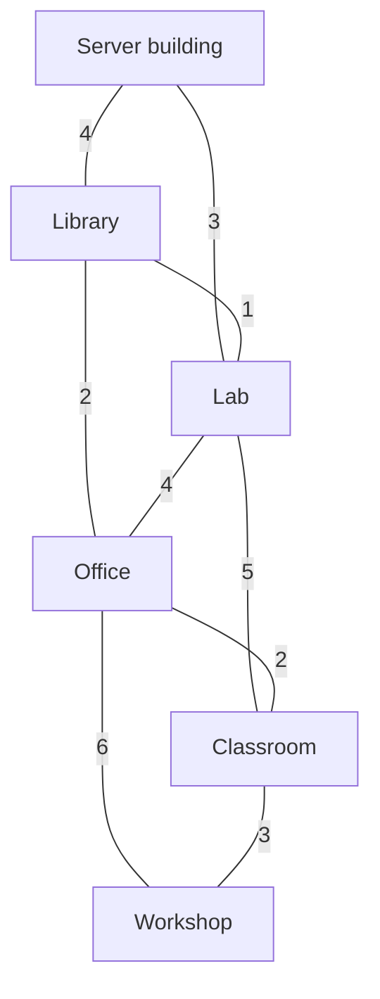
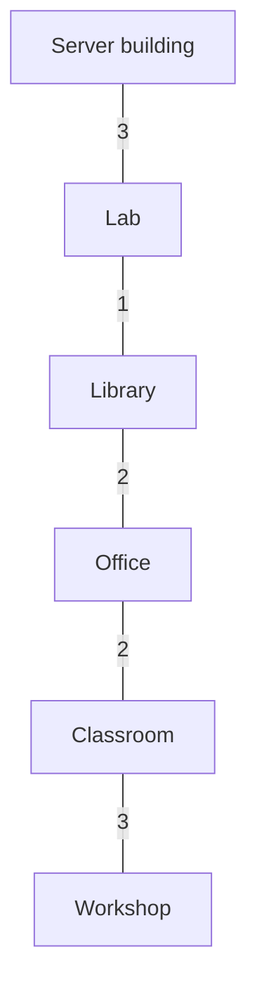

# Minimum spanning tree: connecting a campus

## Problem and prerequisites

Six buildings on a campus need a cable network, and there are nine possible
connections, each with a known installation cost. Choose the connections so that
every building can communicate with every other one at the **minimum total
installation cost**.

## Teaching scope

**In class, only the concept of a minimum spanning tree is mentioned. Prim's algorithm is not taught, and its steps, the argument for its correctness, its implementation and its complexity are not required for the exam.**

The campus network simply illustrates what it means to connect all the vertices
with the minimum total edge weight. This example adds nothing else about
algorithms that you need to study for this topic.

The complete implementation of Prim's algorithm is provided as **optional
additional material** for anyone curious about how such a tree can be computed.
Running the program does not mean that you have to learn the algorithm.

The costs are fictional and given in hundreds of euros. To read the optional
code you need arrays, loops, lists and weighted undirected graphs.

The demo is self-contained: JDK 17 is enough, with no libraries or downloads.

## The candidate network



Each undirected edge represents one possible cable, which works in both
directions. Its label is an installation cost, not a distance or a transmission
delay. Installing all nine cables would cost 30 units (3,000 euros).

## The selected tree



Five cables connect all six buildings without forming a cycle: **6 - 1 = 5
edges**, with a total of **11 units (1,100 euros)**. The starting building
determines the trace, but the aim is to connect all the buildings, not to find
routes from one particular source.

## Optional extension: how Prim makes the choice

Keep a set of selected vertices. For each vertex that is not yet selected,
remember the cheapest single edge that connects it to any selected vertex, and
the endpoint at the other end of that edge. Choose the unselected vertex with
the cheapest such edge, add it to the set, and update the candidate connections.
At the start, only the server building is selected.

| Step | Edge added | Edge cost | Running total |
| --- | --- | ---: | ---: |
| 1 | Server -- Lab | 3 | 3 |
| 2 | Lab -- Library | 1 | 4 |
| 3 | Library -- Office | 2 | 6 |
| 4 | Office -- Classroom | 2 | 8 |
| 5 | Classroom -- Workshop | 3 | 11 |

The edge costs do not have to appear in increasing order: adding Lab makes its
cheaper connection to Library available. Each chosen edge crosses from the
selected set to the rest of the vertices, and the lightest edge across that cut
is always safe for a minimum spanning tree. Adding a vertex that was not
selected before cannot create a cycle.

`cheapest[v]` is the cost of **a single connecting edge**. Unlike a distance in
Dijkstra's algorithm, it is not the sum of the costs along a path from the
server, which is why the update uses `cableCost` and not
`distance[next] + cableCost`.

## A failed connection and an alternative

The program removes Library -- Lab and computes the tree again from scratch. The
replacement is Server -- Library, which raises the optimum from 11 to **14
units**. Restoring the original connection brings the cost back to 11.

This is a planning exercise: recomputing the tree assumes that the other
candidate cables can be installed or used. A tree on its own has no redundant
routes, so if one of its installed edges fails, the tree is split in two. Real
availability requirements may therefore justify extra cables and a larger
budget.

## Three different tree objectives

| Tree | Objective |
| --- | --- |
| BFS discovery tree | Minimum hop count from one source in an unweighted graph |
| Dijkstra shortest-path tree | Minimum weighted path cost from one source |
| Minimum spanning tree | Minimum sum of selected edge weights connecting all vertices |

All three are trees under the appropriate assumptions about connectivity, but
their objectives differ. The MST does not promise the shortest routes from the
server to each building. Nor is this an implementation of the Ethernet
spanning-tree protocol or of Internet routing: the lesson is about the
optimisation problem on the graph.

## Files and representation

- `src/ds/Network.java`: a simple, undirected, weighted graph with fixed vertex
  indices and copies of the device names. The adjacency matrix is symmetric.
- `src/ds/Prim.java`: the minimum spanning tree algorithm. Its result contains
  the chosen edges, in the order in which they were selected, and their total
  cost.
- `src/app/ExampleNetwork.java`: the six buildings and the nine candidate links.
- `src/app/Main.java`: the original network, the optimum, an unavailable link
  and its restoration.
- `tests/tests/ExampleChecks.java`: the contracts and independent checks of
  optimality.

The matrix uses **-1 for a missing edge**, so edges with cost zero are still
valid. This installation-cost model deliberately rejects negative costs; that is
a restriction of the model, not of Prim's algorithm in general. The number of
vertices is fixed when the network is constructed. `links()` lists each
undirected edge once, even though the matrix stores it twice.

## Contracts and edge cases

- A `null` array of names, a `null`, blank or duplicate name, an invalid index
  and a negative cost all throw `IllegalArgumentException`, from simple explicit
  checks.
- The array of names is copied, and the names are immutable strings.
- Adding a self-loop or a link that already exists returns `false`, and a
  duplicate insertion keeps the original cost. Adding or removing a link updates
  both directions.
- `cost(u, v)` returns -1 if the edge is missing, and `removeLink` returns
  `false` if there is nothing to remove.
- Empty and single-vertex graphs return an empty selection with a total of zero.
  For the empty graph, this is a convenient convention for the result, not a
  claim that it is a tree.
- A disconnected graph throws `IllegalStateException`, because no spanning tree
  exists. Returning a spanning forest would need a different contract, and it is
  not implemented here.
- Costs may be as large as `Integer.MAX_VALUE`. Totals and pending minimum
  values use `long`, so adding up valid integer edge costs cannot overflow.
- Ties between candidate costs are broken deterministically by vertex index: a
  new edge that is just as cheap does not replace the parent remembered first.
- The algorithm does not modify the network. Results and edge lists are
  unmodifiable snapshots, so later changes to the network do not alter earlier
  results.
- Do not modify a network while Prim's algorithm is running. Results are
  instances of an ordinary nested class with `links()` and `totalCost()`
  accessors; calling its constructor directly does not certify that the tree is
  a valid minimum tree.

## Optional extension: implementation complexity

For V buildings, the matrix takes up **O(V²)** space. Looking up, inserting or
removing a link takes O(1), while listing the links scans the matrix in O(V²).
The simple check for duplicate names in the constructor also takes O(V²).

Prim's algorithm chooses the next vertex with a linear scan and then scans that
vertex's row of the matrix. It performs at most V iterations, so it takes
**O(V²) time**, with **O(V) extra space** for the marks, the candidate costs,
the parents and the resulting tree. A priority queue and adjacency lists can
make it faster on sparse graphs, but they are not needed to explain this
six-building example.

## Run

From this demo's folder, on Windows:

```powershell
.\run.cmd
.\run.cmd test
```

On macOS or Linux:

```bash
bash run.sh
bash run.sh test
```

The scripts compile with Java 17, with all warnings enabled and treated as
errors. Alternatively, open this folder in VS Code and run `app.Main`.

## Expected output

```text
Campus network: fictional installation costs in hundreds of euros.
Available undirected links (fictional installation cost units):
  Server -- Library : 4
  Server -- Lab : 3
  Library -- Lab : 1
  Library -- Office : 2
  Lab -- Office : 4
  Lab -- Classroom : 5
  Office -- Classroom : 2
  Office -- Workshop : 6
  Classroom -- Workshop : 3
Installing every link: 30

Minimum spanning tree:
  Server -- Lab : 3
  Lab -- Library : 1
  Library -- Office : 2
  Office -- Classroom : 2
  Classroom -- Workshop : 3
Selected links: 5 for 6 nodes
Total cost: 11
All currently available links: 30; saving with this tree: 19

Incident: Library -- Lab is unavailable.

Recomputed minimum spanning tree:
  Server -- Lab : 3
  Server -- Library : 4
  Library -- Office : 2
  Office -- Classroom : 2
  Classroom -- Workshop : 3
Selected links: 5 for 6 nodes
Total cost: 14
All currently available links: 29; saving with this tree: 15

Link restored:
  Server -- Lab : 3
  Lab -- Library : 1
  Library -- Office : 2
  Office -- Classroom : 2
  Classroom -- Workshop : 3
Selected links: 5 for 6 nodes
Total cost: 11
All currently available links: 30; saving with this tree: 19

A tree has no redundant route: one selected link failure disconnects it.
Recomputation assumes the other candidate links are available.
Minimum total installation cost is not minimum latency from the server.
```

## Optional exploration questions (not exam requirements)

1. Why are five edges enough, and why would four not be?
2. Why is the edge with cost 1 selected after the edge with cost 3?
3. Why does this tree not necessarily give the shortest paths from the server?
4. What changes if an edge that was not selected becomes unavailable?
5. What would you add if communication had to survive the failure of any one
   cable?
6. What should the program report if every connection to Workshop is removed?

On small graphs, the tests go through every subset of V-1 edges, check its
connectivity independently, and compare the cheapest total with the one found by
Prim's algorithm. They include zero weights, equal costs, disconnected networks,
large integer costs and the incident scenario.
