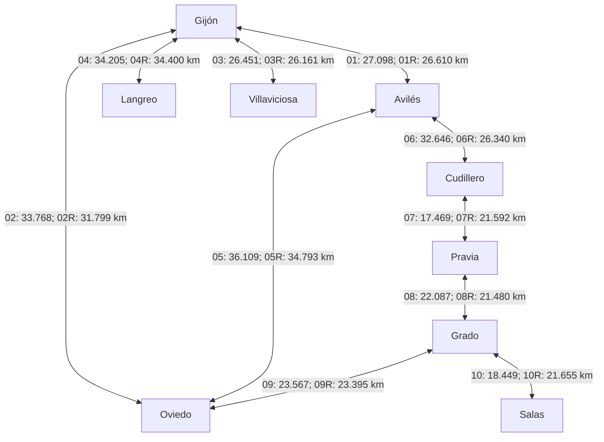
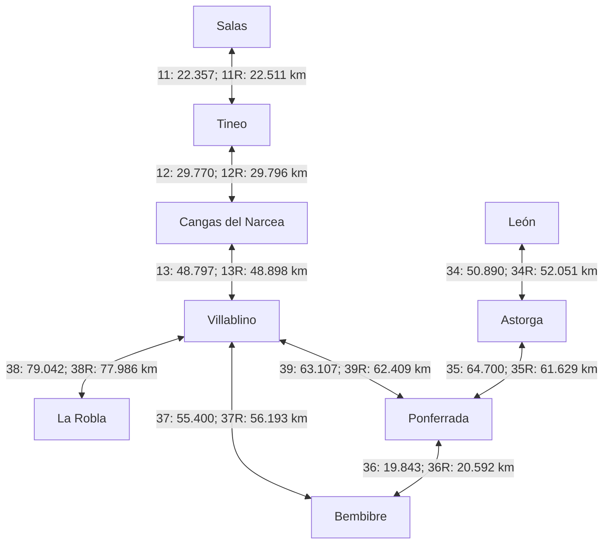
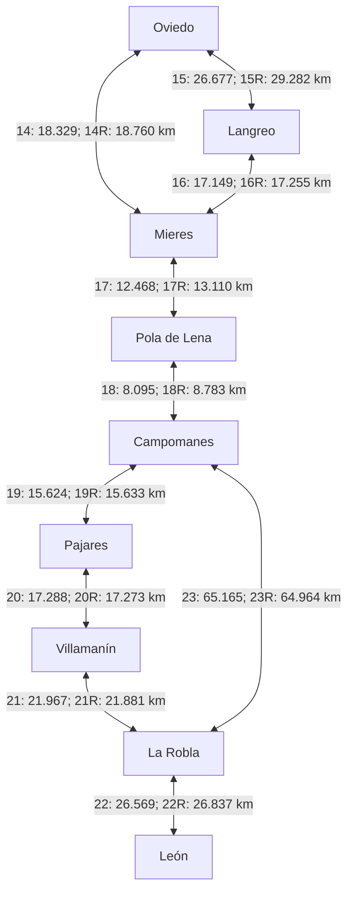
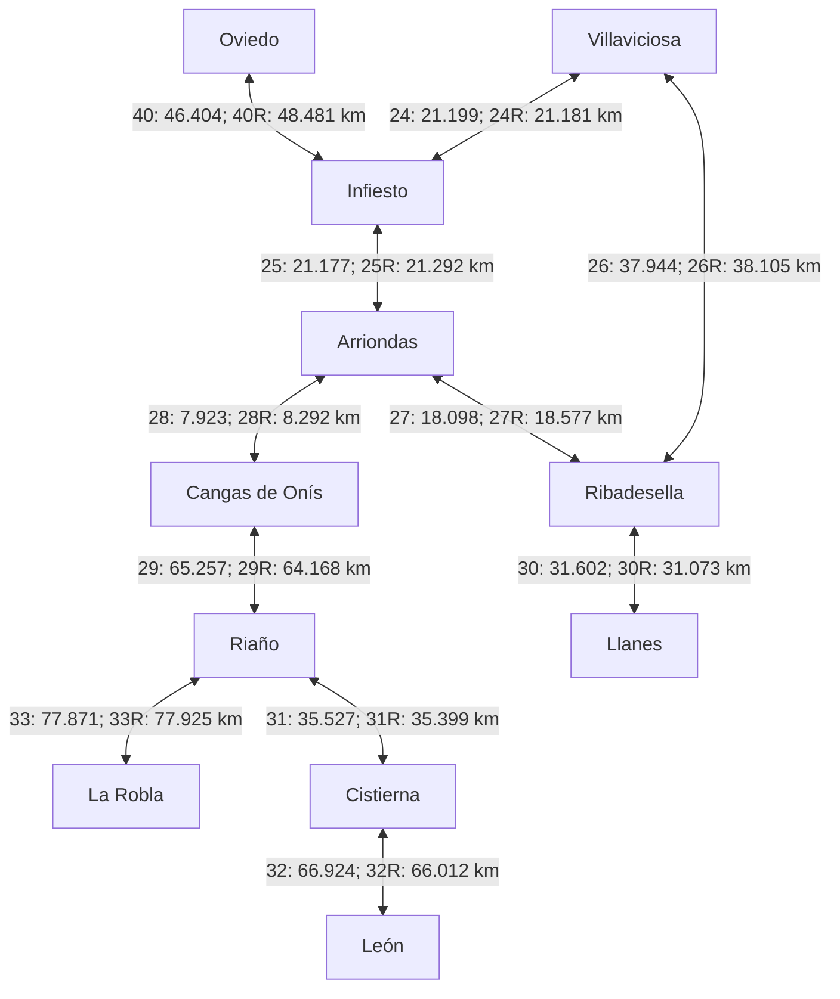
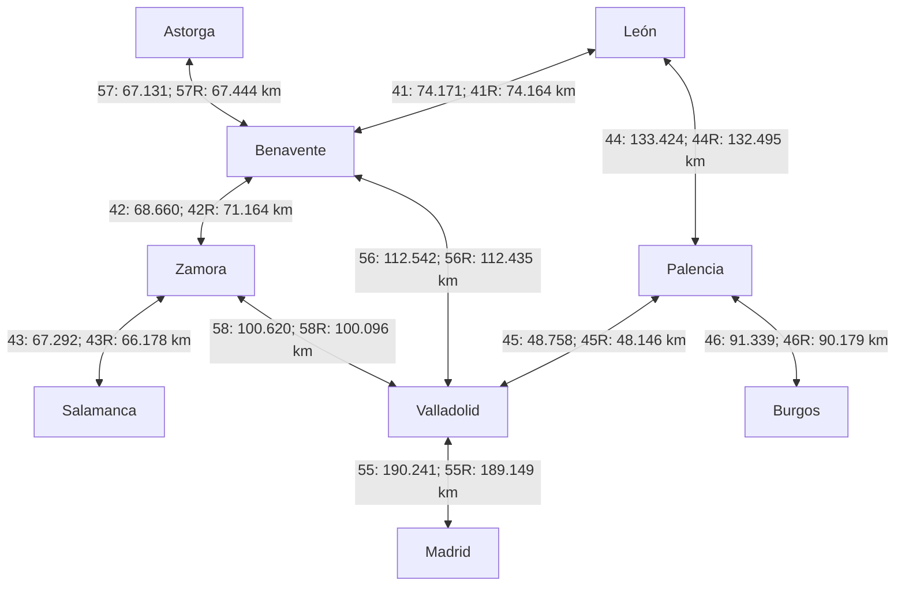
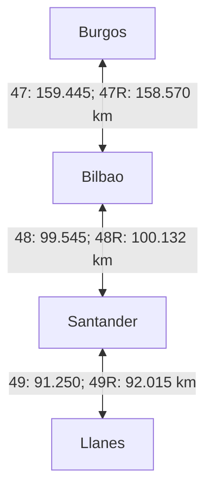
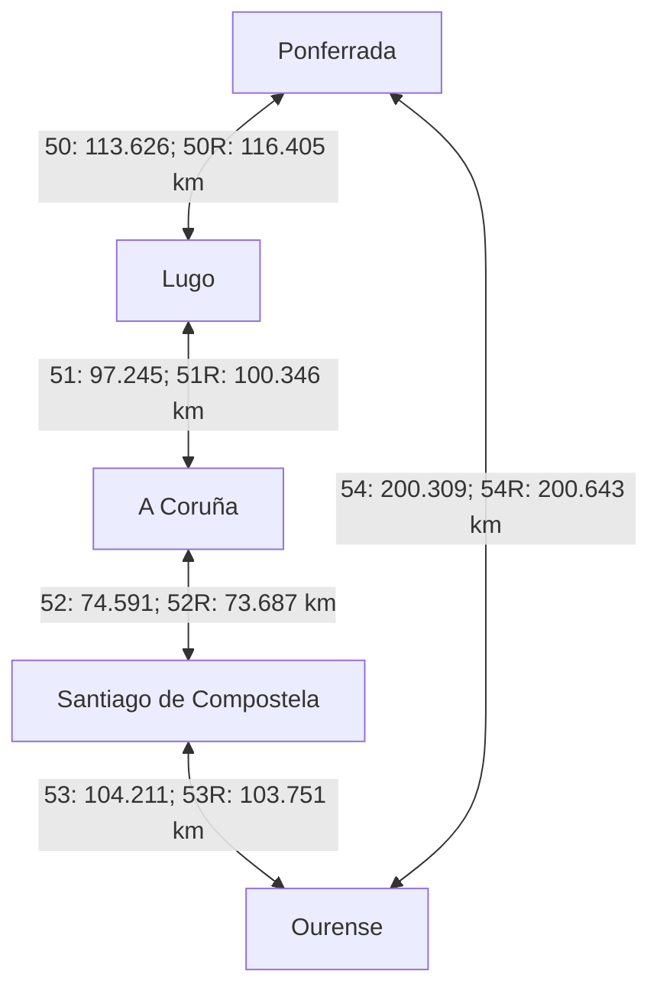
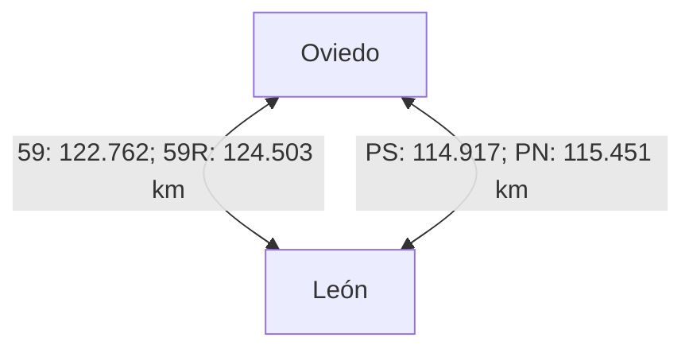

# Road navigation: shortest paths and temporary incidents

## Goal and prerequisites

Choose an origin and a destination, compute a route, remove a road and ask
Dijkstra's algorithm for an alternative. Then restore the road, give it a large
temporary weight, and repeat. The program prints the road alternatives actually
selected, together with their physical length in kilometres and, separately, the
routing cost.

First read the Topic 6 material on the adjacency-map representation,
non-negative weights, relaxation and the invariant of Dijkstra's algorithm.
Maps, sets, comparators and priority queues come from earlier topics.
`WeightedGraph` and its two versions of Dijkstra's algorithm, one with a linear
scan and one with a heap, are unchanged. The new navigation layer supplies the
roads and the state of the incidents.

<!-- BEGIN GENERATED ROAD GRAPH -->
## Graph of the bundled road network

The diagrams below show **all 42 localities and all 120 directed road
alternatives** in `data/northern-spain.json`. They are schematic graphs, not
geographic maps: the shape and position of the lines say nothing about the roads
themselves. A locality that appears in more than one panel is the same vertex of
the single, complete graph.

**Legend:** each node is the reference point of a locality. To keep the diagrams
readable, each double-headed connection stands for **two separate directed
arcs**. Its label uses short IDs: `01` means `road-01` and `01R` means
`road-01-reverse`, while `PS` and `PN` mean `pajares-south` and `pajares-north`.
Each ID is followed by the physical distance of that arc in kilometres, rounded
to three decimals. The order of the IDs in a label does not indicate a direction
on the page; look each ID up in the table to find its direction, road references
and incident tags. The two arcs of a pair can differ in both distance and road
references.

With no incidents, **weight = kilometres**. During an incident, **weight =
kilometres + penalty**, whereas a closure removes the arc altogether. The
diagrams show the original network, with every penalty at zero. Penalties are
cost units for teaching purposes, not minutes, and the distances come from a
saved snapshot of the map, not from live measurements.

An arc may follow several roads and pass through other places that are not
vertices of the graph. Where two lines cross there is no junction unless a
labelled node is drawn there. The parallel connections between Oviedo and León
are separate route alternatives. To see the actual shape of the roads and the
five incident scenarios, use the offline HTML viewer described below.

### Central coast and western Asturias



| Arc ID | Direction | Road references | Distance (km) | Incident tags |
| --- | --- | --- | ---: | --- |
| `road-01` | Gijón → Avilés | GJ-81, A-8, AI-81, AS-392 | 27.098 | None |
| `road-01-reverse` | Avilés → Gijón | N-632a, AS-392, AI-81, A-8, GJ-81 | 26.610 | None |
| `road-02` | Gijón → Oviedo | GJ-81, A-8, A-66R, A-63, O-12, N-630 | 33.768 | None |
| `road-02-reverse` | Oviedo → Gijón | N-630, O-11, A-66, A-66R, A-8, GJ-81 | 31.799 | None |
| `road-03` | Gijón → Villaviciosa | N-632, A-8 | 26.451 | None |
| `road-03-reverse` | Villaviciosa → Gijón | AS-380, N-632, A-8 | 26.161 | None |
| `road-04` | Gijón → Langreo | AS-I, AS-117, AS-117a, AS-269, AS-376, LA-3 | 34.205 | None |
| `road-04-reverse` | Langreo → Gijón | LA-3, AS-376, AS-117a, AS-269, AS-I | 34.400 | None |
| `road-05` | Avilés → Oviedo | N-632a, AS-392, AI-81, A-8, A-66R, A-66, A-63, O-12, N-630 | 36.109 | None |
| `road-05-reverse` | Oviedo → Avilés | N-630, O-11, A-66, A-66R, A-8, AI-81, AS-392 | 34.793 | None |
| `road-06` | Avilés → Cudillero | N-632a, AS-17, N-632, A-8, CU-3, CU-2 | 32.646 | None |
| `road-06-reverse` | Cudillero → Avilés | CU-2, N-632, A-8, AS-237 | 26.340 | None |
| `road-07` | Cudillero → Pravia | CU-2, N-632, AS-16, AS-347, PV-4 | 17.469 | None |
| `road-07-reverse` | Pravia → Cudillero | PV-4, AS-368, AS-347, AS-16, A-8, CU-3, CU-2 | 21.592 | None |
| `road-08` | Pravia → Grado | PV-4, AS-368, AS-347, AS-16, N-634 | 22.087 | None |
| `road-08-reverse` | Grado → Pravia | N-634, AS-16, AS-347, PV-4 | 21.480 | None |
| `road-09` | Grado → Oviedo | N-634, A-63, N-630, O-12 | 23.567 | None |
| `road-09-reverse` | Oviedo → Grado | O-12, N-630, N-634 | 23.395 | None |
| `road-10` | Grado → Salas | N-634, A-63, N-634a | 18.449 | None |
| `road-10-reverse` | Salas → Grado | N-634a, N-634 | 21.655 | None |

### Western mountains and El Bierzo



| Arc ID | Direction | Road references | Distance (km) | Incident tags |
| --- | --- | --- | ---: | --- |
| `road-11` | Salas → Tineo | N-634a, AS-216 | 22.357 | None |
| `road-11-reverse` | Tineo → Salas | AS-216, N-634, N-634a | 22.511 | None |
| `road-12` | Tineo → Cangas del Narcea | AS-215, AS-15, AS-213 | 29.770 | None |
| `road-12-reverse` | Cangas del Narcea → Tineo | AS-213, AS-15, AS-215 | 29.796 | None |
| `road-13` | Cangas del Narcea → Villablino | AS-213, LE-497, CL-626 | 48.797 | None |
| `road-13-reverse` | Villablino → Cangas del Narcea | LE-3309, CL-626, LE-497, AS-213 | 48.898 | None |
| `road-34` | León → Astorga | LE-30, AP-71, N-6 | 50.890 | None |
| `road-34-reverse` | Astorga → León | N-120a, N-120A, LE-420, AP-71, LE-20 | 52.051 | None |
| `road-35` | Astorga → Ponferrada | LE-133, LE-6425, A-6, N-6 | 64.700 | None |
| `road-35-reverse` | Ponferrada → Astorga | N-6, A-6 | 61.629 | None |
| `road-36` | Ponferrada → Bembibre | N-6, A-6, LE-5312 | 19.843 | None |
| `road-36-reverse` | Bembibre → Ponferrada | LE-5312, N-6, A-6 | 20.592 | None |
| `road-37` | Bembibre → Villablino | LE-5312, N-6, LE-463, CL-631, LE-3308 | 55.400 | None |
| `road-37-reverse` | Villablino → Bembibre | LE-3308, CL-631, LE-463, N-6, LE-5312 | 56.193 | None |
| `road-38` | Villablino → La Robla | CL-626, AP-66 | 79.042 | AP-66 |
| `road-38-reverse` | La Robla → Villablino | N-630, CL-626, AP-66 | 77.986 | AP-66 |
| `road-39` | Villablino → Ponferrada | LE-3308, CL-631 | 63.107 | None |
| `road-39-reverse` | Ponferrada → Villablino | CL-631, LE-3308 | 62.409 | None |

### Central Asturias and the mountain passes



| Arc ID | Direction | Road references | Distance (km) | Incident tags |
| --- | --- | --- | ---: | --- |
| `road-14` | Oviedo → Mieres | O-12, A-66 | 18.329 | None |
| `road-14-reverse` | Mieres → Oviedo | A-66, O-12 | 18.760 | None |
| `road-15` | Oviedo → Langreo | N-630, O-11, A-66, O-14, A-64, AS-17, AS-117, AS-117a, AS-269, AS-376, LA-3 | 26.677 | None |
| `road-15-reverse` | Langreo → Oviedo | LA-3, AS-376, AS-117a, AS-269, AS-17, A-64, A-66, A-63, O-12, N-630 | 29.282 | None |
| `road-16` | Langreo → Mieres | LA-3, AS-376, AS-117a, AS-269, AS-117, AS-I | 17.149 | None |
| `road-16-reverse` | Mieres → Langreo | AS-I, AS-117, AS-117a, AS-269, AS-376, LA-3 | 17.255 | None |
| `road-17` | Mieres → Pola de Lena | MI-2, A-66, LN-1, AS-375 | 12.468 | None |
| `road-17-reverse` | Pola de Lena → Mieres | AS-242, N-630, LN-1, A-66 | 13.110 | None |
| `road-18` | Pola de Lena → Campomanes | AS-242, N-630, LN-1, A-66 | 8.095 | None |
| `road-18-reverse` | Campomanes → Pola de Lena | N-630, A-66, LN-1, AS-375 | 8.783 | None |
| `road-19` | Campomanes → Pajares | N-630 | 15.624 | None |
| `road-19-reverse` | Pajares → Campomanes | N-630 | 15.633 | None |
| `road-20` | Pajares → Villamanín | N-630, LE-3505 | 17.288 | N-630-Pajares |
| `road-20-reverse` | Villamanín → Pajares | LE-3505, N-630 | 17.273 | N-630-Pajares |
| `road-21` | Villamanín → La Robla | LE-3505, LE-3503, N-630, CL-626 | 21.967 | None |
| `road-21-reverse` | La Robla → Villamanín | N-630, LE-3505 | 21.881 | None |
| `road-22` | La Robla → León | N-630, N-630A | 26.569 | None |
| `road-22-reverse` | León → La Robla | N-630, CL-626 | 26.837 | None |
| `road-23` | Campomanes → La Robla | N-630, A-66, CL-626 | 65.165 | None |
| `road-23-reverse` | La Robla → Campomanes | N-630, CL-626, AP-66, A-66 | 64.964 | AP-66 |

### Eastern Asturias and eastern León



| Arc ID | Direction | Road references | Distance (km) | Incident tags |
| --- | --- | --- | ---: | --- |
| `road-24` | Villaviciosa → Infiesto | AS-380, AS-255, N-634, N-634a | 21.199 | None |
| `road-24-reverse` | Infiesto → Villaviciosa | N-634a, N-634, AS-255, VV-16 | 21.181 | None |
| `road-25` | Infiesto → Arriondas | N-634a, N-634 | 21.177 | None |
| `road-25-reverse` | Arriondas → Infiesto | N-634, N-634a | 21.292 | None |
| `road-26` | Villaviciosa → Ribadesella | AS-380, N-632, A-8 | 37.944 | None |
| `road-26-reverse` | Ribadesella → Villaviciosa | N-632, A-8 | 38.105 | None |
| `road-27` | Arriondas → Ribadesella | N-634, N-632 | 18.098 | None |
| `road-27-reverse` | Ribadesella → Arriondas | N-632, N-634 | 18.577 | None |
| `road-28` | Arriondas → Cangas de Onís | N-625 | 7.923 | None |
| `road-28-reverse` | Cangas de Onís → Arriondas | N-625 | 8.292 | None |
| `road-29` | Cangas de Onís → Riaño | N-625, N-621 | 65.257 | None |
| `road-29-reverse` | Riaño → Cangas de Onís | N-625 | 64.168 | None |
| `road-30` | Ribadesella → Llanes | N-632, N-634, A-8, AS-379 | 31.602 | None |
| `road-30-reverse` | Llanes → Ribadesella | LLN-7, AS-379, A-8, N-634, N-632 | 31.073 | None |
| `road-31` | Riaño → Cistierna | N-621 | 35.527 | None |
| `road-31-reverse` | Cistierna → Riaño | N-621 | 35.399 | None |
| `road-32` | Cistierna → León | N-621, CL-626, CL-624, LE-20 | 66.924 | None |
| `road-32-reverse` | León → Cistierna | N-621, CL-624, CL-626 | 66.012 | None |
| `road-33` | Riaño → La Robla | N-621, CL-626 | 77.871 | None |
| `road-33-reverse` | La Robla → Riaño | CL-626, N-621 | 77.925 | None |
| `road-40` | Oviedo → Infiesto | N-630, O-11, A-66, O-14, A-64, AS-119, N-634R, N-634a | 46.404 | None |
| `road-40-reverse` | Infiesto → Oviedo | N-634a, N-634, A-64, A-66, A-63, O-12, N-630 | 48.481 | None |

### Castile and the connection to Madrid



| Arc ID | Direction | Road references | Distance (km) | Incident tags |
| --- | --- | --- | ---: | --- |
| `road-41` | León → Benavente | LE-20, LE-11, A-231, A-66, A-6, N-630 | 74.171 | None |
| `road-41-reverse` | Benavente → León | N-VIa, N-6, A-6, A-66, A-231, LE-11, LE-20 | 74.164 | None |
| `road-42` | Benavente → Zamora | N-VIa, N-6, A-6, A-66, N-630, ZA-11, ZA-20 | 68.660 | None |
| `road-42-reverse` | Zamora → Benavente | ZA-20, ZA-11, A-11, A-66, A-6, N-VIa | 71.164 | None |
| `road-43` | Zamora → Salamanca | ZA-20, CL-605, A-66, SA-11, N-620 | 67.292 | None |
| `road-43-reverse` | Salamanca → Zamora | SA-11, A-66, CL-605, ZA-20 | 66.178 | None |
| `road-44` | León → Palencia | LE-20, LE-30, A-60, A-231, CL-615 | 133.424 | None |
| `road-44-reverse` | Palencia → León | CL-615, A-231, A-60, LE-30, LE-20 | 132.495 | None |
| `road-45` | Palencia → Valladolid | P-11, A-67, A-62, VA-20 | 48.758 | None |
| `road-45-reverse` | Valladolid → Palencia | VA-20, A-62, A-67, P-11 | 48.146 | None |
| `road-46` | Palencia → Burgos | A-610, A-62, BU-30, BU-11 | 91.339 | None |
| `road-46-reverse` | Burgos → Palencia | BU-11, BU-30, A-62, A-610 | 90.179 | None |
| `road-55` | Valladolid → Madrid | N-601, AP-6, A-6 | 190.241 | None |
| `road-55-reverse` | Madrid → Valladolid | A-6, AP-6, N-601 | 189.149 | None |
| `road-56` | Benavente → Valladolid | N-VIa, N-6, A-6, A-62 | 112.542 | None |
| `road-56-reverse` | Valladolid → Benavente | A-62, A-6, N-VIa | 112.435 | None |
| `road-57` | Astorga → Benavente | LE-133, LE-6425, A-6, N-630 | 67.131 | None |
| `road-57-reverse` | Benavente → Astorga | N-VIa, N-6, A-6, LE-6425, LE-133 | 67.444 | None |
| `road-58` | Zamora → Valladolid | ZA-12, A-11, A-62, A-6 | 100.620 | None |
| `road-58-reverse` | Valladolid → Zamora | A-62, A-6, A-11, ZA-12 | 100.096 | None |

### Cantabrian coast



| Arc ID | Direction | Road references | Distance (km) | Incident tags |
| --- | --- | --- | ---: | --- |
| `road-47` | Burgos → Bilbao | BU-11, BU-805, A-1, AP-1, AP-68, A-8, BI-10 | 159.445 | None |
| `road-47-reverse` | Bilbao → Burgos | BI-10, A-8, AP-68, AP-1, BU-805, BU-11 | 158.570 | None |
| `road-48` | Bilbao → Santander | BI-10, A-8, S-10 | 99.545 | None |
| `road-48-reverse` | Santander → Bilbao | S-21, S-10, A-8 | 100.132 | None |
| `road-49` | Santander → Llanes | S-20, A-67, A-67a, A-8, AS-379 | 91.250 | None |
| `road-49-reverse` | Llanes → Santander | LLN-7, AS-379, A-8, A-67, S-10 | 92.015 | None |

### Galicia



| Arc ID | Direction | Road references | Distance (km) | Incident tags |
| --- | --- | --- | ---: | --- |
| `road-50` | Ponferrada → Lugo | CL-631, A-6, LU-11 | 113.626 | None |
| `road-50-reverse` | Lugo → Ponferrada | LU-530, A-6, CL-631 | 116.405 | None |
| `road-51` | Lugo → A Coruña | N-640, A-6, AP-9M, AP-9, AC-11 | 97.245 | None |
| `road-51-reverse` | A Coruña → Lugo | AC-11, AP-9, AP-9M, A-6, LU-530, LU-P-2925 | 100.346 | None |
| `road-52` | A Coruña → Santiago de Compostela | AC-11, AP-9, SC-20 | 74.591 | None |
| `road-52-reverse` | Santiago de Compostela → A Coruña | SC-20, AP-9, AC-11 | 73.687 | None |
| `road-53` | Santiago de Compostela → Ourense | SC-20, SC-11, AP-53, AG-53, A-52, OU-11, N-120 | 104.211 | None |
| `road-53-reverse` | Ourense → Santiago de Compostela | N-120, OU-11, A-52, AG-53, AP-53, SC-11, SC-20 | 103.751 | None |
| `road-54` | Ourense → Ponferrada | N-525, N-540, A-54, A-6, CL-631 | 200.309 | None |
| `road-54-reverse` | Ponferrada → Ourense | CL-631, A-6, A-54, N-540, N-525 | 200.643 | None |

### Direct Oviedo–León alternatives



| Arc ID | Direction | Road references | Distance (km) | Incident tags |
| --- | --- | --- | ---: | --- |
| `road-59` | Oviedo → León | O-12, A-66, AP-66, N-120 | 122.762 | AP-66 |
| `road-59-reverse` | León → Oviedo | LE-30, AP-66, A-66, O-12 | 124.503 | AP-66 |
| `pajares-south` | Oviedo → León | O-12, A-66, N-630, N-630A | 114.917 | N-630-Pajares |
| `pajares-north` | León → Oviedo | N-630, A-66, O-12 | 115.451 | N-630-Pajares |

The diagrams and tables are generated from the JSON file, so every ID and
distance can be traced back to it. After changing that file, run
`python tools/update_readme_graph.py` from this demo folder to update them.
<!-- END GENERATED ROAD GRAPH -->

## Run the demonstration

Open this folder on its own in VS Code, with JDK 17 or newer, and use **Run** on
`src/app/Main.java`. The default trip is **Gijón → Madrid**.

On Windows, from PowerShell, Command Prompt or the VS Code terminal:

```powershell
.\run.cmd
.\run.cmd test
.\run.cmd run data/northern-spain.json "Oviedo" "León"
.\run.cmd run data/northern-spain.json "Cudillero" "Cangas de Onís"
```

On macOS and Linux:

```sh
bash run.sh
bash run.sh test
bash run.sh run data/northern-spain.json 'Oviedo' 'León'
```

Give all three arguments: the JSON file, the origin and the destination. An
optional fourth argument chooses the ID of one directed road for the incident.
Without it, the demo uses the tagged Pajares pass if there is one, then the AP-66,
and otherwise the first connection. If the destination is unreachable or equal
to the origin, the demo prints the result and does not invent a road to disrupt.
Unknown names are reported as errors. All the scripts set their own working
directory. On Windows you need `java` and `javac` on `PATH`, but not Bash or WSL.
Gson and the annotation library it depends on are bundled in `lib`, together
with their licences. Running the demo needs no internet connection.

## Offline graphical demonstration

Every normal run also writes **`bin/navigation-map.html`**. Open that file in a
browser. It is a self-contained HTML document, so it works from `file://`, offline
and after being copied to another computer, and it needs no web server, API key
or browser library. The next run overwrites it with the new origin and
destination. Generated files stay in the `bin` directory, which Git ignores.

From **this demo's folder**, on macOS:

```sh
bash run.sh run data/northern-spain.json 'Oviedo' 'León'
open bin/navigation-map.html
```

On Windows, after the same run with `.\run.cmd`, use
`start bin\navigation-map.html` in Command Prompt, or
`Start-Process .\bin\navigation-map.html` in PowerShell.
On Linux, use `xdg-open bin/navigation-map.html` or open the file from the file
manager. These route arguments are for `Demo03WeightedGraph/run.sh`.

The viewer opens at **step 1: No incident**. Use buttons 1–5 in order: they are
successive moments of the same journey, not five independent route options. Blue
always shows the original route, and orange shows the route for the selected
step. Dashed red lines show the **whole graph connections affected**, not the
exact point of the incident. Select any of the five scenario buttons to see its
saved route, physical distance and routing cost, and the details of each
connection. Where blue and orange lines coincide, the routes share a road. The
table keeps the order and direction of travel, reverse edges included. Use **Fit
routes**, **Iberian Peninsula**, the zoom buttons, the mouse wheel or dragging to
explore the map. **Show sampled network** adds the other corridors in the data.
Click a road, or select it in the table, to see its ID, references and penalty.

The geographic background is an offline map of country outlines from Natural
Earth, not a street-level tile map, and the routes follow the saved OSRM road
geometry. No live traffic or remote tiles are loaded. When you zoom in, the
country outlines are deliberately coarse, while the road geometry is more
detailed. The peninsula view covers the area of this network, not every Spanish
territory.

`NavigationMapWriter` exports immutable snapshots of the Java routes, and
`web/navigation-map.html` only draws them. Switching scenario does **not** run
Dijkstra's algorithm in JavaScript; to change the origin, the destination or the
incident, run the Java program again. The viewer is supporting presentation
material, separate from the lesson on graphs and algorithms.

An unreachable route is labelled **No route** and has infinite cost, and a route
from a locality to itself has zero cost. A custom JSON file without the optional
coordinates or geometry still loads: the viewer leaves out the shapes it does not
have and reports that the geometry of a selected road is missing, instead of
drawing invented straight lines.

## The map data

`data/northern-spain.json` contains **42 localities and 120 directed road
alternatives**. It keeps the original network of Asturias and León and extends
it to Benavente, Zamora, Salamanca, Valladolid, Palencia, Burgos, Santander,
Bilbao, Lugo, A Coruña, Santiago de Compostela, Ourense and Madrid.

The weights now come from **OSRM routes on OpenStreetMap**, queried on 18
September 2026. They are road lengths taken from the map, not invented distances
or straight-line measurements. Each locality has an explicit reference
coordinate, which OSRM snaps to the road network. The two directions were
queried separately, so their lengths need not be the same.

Each edge represents a **whole directed corridor between two reference points**,
including any access streets in towns. Its name lists the road references
returned by OSRM, in the order in which they are travelled. A corridor can use
several numbered roads and can pass other localities without stopping at their
reference points, so it is not a single physical stretch of road. Only the
corridors represented in the data can be chosen or combined, and roads crossing
inside a corridor are not extra vertices of the graph.

OSRM supplies a recommended driving route for each pair. The Pajares
alternatives, requested separately, use a waypoint in Pajares/Payares so that
they follow the N-630 corridor. The alternatives kept between Oviedo and León
distinguish the AP-66 route from the N-630 option. Dijkstra's algorithm
minimises distance or cost within this **sampled network**, not over every road
in Spain. The OSRM route service optimises its own driving profile, so a
corridor it returns is not guaranteed to be the shortest possible in physical
distance.

Each road also stores a `geometry`: a polyline encoded with precision 5
(latitude and longitude differences in units of 1e-5 degrees). It joins the step
geometries from the same fingerprinted OSRM response, removing consecutive
duplicate points but not simplifying it any further. The geometry is only used
for display and never changes a weight. `referenceCoordinates` places the
locality labels on the map.

`data/map-context.json` contains the country outlines of Spain and its
neighbours, extracted from the 1:50m country dataset of Natural Earth. Its
source URL and public-domain attribution are included in that file and in the
HTML viewer.

Every road in the JSON includes the URL of its query. `data/route-evidence.json`
records the distance returned in metres, the road steps, the snapped
coordinates, the retrieval time and a SHA-256 fingerprint of the original
response. Dividing the metres by 1000 gives the stored kilometres. The service
did not report the date of its OSM extract, so the retrieval time must not be
taken as the publication date of the underlying map. Live traffic, closures,
toll prices and current accessibility are not queried.

Sources and attribution:

- [OSRM route API](https://project-osrm.org/docs/v5.24.0/api/#route-service).
- © [OpenStreetMap contributors](https://www.openstreetmap.org/copyright). The
  dataset derived from the map is supplied under ODbL 1.0, with attribution and
  the corresponding share-alike terms. That licence applies to the dataset; it
  does not automatically apply to the Java implementation.

The old invented network is kept only as a fixture for regression tests, in
`tests/data/illustrative-network.json`; the demonstration never loads it.

## Classroom sequence

1. **Original route.** Look at its localities, road IDs and references,
   kilometres and total cost. With no incidents, the cost equals the distance.
2. **Connections removed.** Call `removeRoad(id)` and recompute. Keep the
   removed objects, so that they can be restored with `addRoad`.
3. **Connections restored.** Recompute with the original network.
4. **Large temporary penalty.** Add 1000 cost units to each affected connection
   and recompute. The road still exists, and it may be chosen if no cheaper
   route is available. This is not the same as removing or closing it.
5. **Penalty removed.** Set the penalty back to zero and recompute once more.

`try`/`finally` makes sure that temporary changes are undone even if the
recalculation fails. These experiments never change the JSON file. Every
scenario shown runs both implementations of Dijkstra's algorithm and compares
all the computed costs.

For the Pajares pass, the demonstration removes or penalises **every represented
connection tagged `N-630-Pajares`, in both directions**. These tags identify the
N-630 route geometry that crosses the area of the pass, not every road with the
N-630 reference. The JSON documents the coordinate bounds, and the evidence file
records the matching points. AP-66 is a second corridor tag, based on its exact
road reference. Grouping connections in this way prevents an incident from being
silently bypassed through another, overlapping connection. The tags describe
this teaching snapshot; they are not precise, real-time limits of an incident.
For a localised incident, split the corridors at the incident or junction and
give the parts separate edge IDs. Passing a road ID explicitly changes only that
one directed edge; it does not close the other corridors that may share
stretches of the same physical road.

### What the five buttons mean

| Step | Change to the graph | Meaning |
| --- | --- | --- |
| 1. No incident | Original weights | Calculate the baseline route. |
| 2. Road closed | Remove affected connections | These roads cannot be used, even if no alternative exists. |
| 3. Road reopened | Add them back | Recover the original minimum cost. |
| 4. Heavy traffic (+1000) | Keep the roads and increase their weights | A penalised road remains usable if it is still the best or only option. |
| 5. Traffic cleared | Reset penalties to zero | Recover the original minimum cost again. |

For the bundled trip from Oviedo to León, steps **1, 3 and 5** use Pajares,
while steps **2 and 4** use the AP-66; the repeated results show that the
network has been restored. Other trips may behave differently, because a closure
and a large penalty are not equivalent. The penalty is a classroom simulation of
traffic, not a measurement in minutes. Where the blue and orange lines overlap,
the original route and the selected route share the same road.

## Distance, cost and alternatives

`Road.kilometres()` never changes, and `Road.cost()` is `kilometres + penalty`.
A penalty is measured in **cost units equivalent to distance**, not in extra
kilometres of road or in measured minutes of delay, and the output prints the
physical distance separately. This is a simple classroom model of how a
navigator responds, not a model of live traffic or travel time. A time-based
version would need consistent baseline travel times and delay weights for every
connection.

`Road.setClosed(true)` is another reversible operation: building a route skips
that road, and `setClosed(false)` reopens it. Closing a road leaves its previous
penalty intact, and `setPenalty(0)` clears a penalty. All weights must be finite
and non-negative, and an invalid change leaves the road unchanged. Alternatives
with the same cost are perfectly legitimate, so restoring the network guarantees
the original optimum cost, not that the same path is found.

Parallel roads must not overwrite one another. The navigation network stores
`Road` objects by **unique ID**, which allows several roads from A to B. For
each query, it selects the cheapest open road for each ordered pair and builds a
new, simple `WeightedGraph`. With a single additive cost, a more expensive
parallel edge can never improve a path, so this reduction preserves the optimum.
All the alternatives stay in the navigation network and are considered again
after an incident.

The chosen `Road` is kept next to each arc of the graph. The returned `Route`
takes snapshots of the IDs, names, distances and penalties, so later changes
cannot rewrite an earlier result. If there is no path to the destination, the
route has infinite cost and distance; a route from a locality to itself has zero
cost and no legs. This design reuses the existing implementations of Dijkstra's
algorithm without changing their graph contract.

## Code walkthrough

- `Road`: one directed alternative, with immutable identifying data and
  distance, a closure flag and penalty that can change, and explicit validation.
- `NavigationNetwork`: the localities and alternative roads, their removal and
  restoration, and the construction of the current weighted graph.
- `WeightedGraph`: sorted adjacency maps, plus Dijkstra with a linear scan for
  the minimum and with a priority queue of immutable entries that skips stale
  ones. A copy of a graph owns its own maps, and read-only views of the
  neighbours prevent structural changes from outside.
- `ShortestPaths`: an independent snapshot of distances and predecessors, and
  path reconstruction.
- `Route`: the selected roads and the costs captured for them, kept separate
  from the distance.
- `NavigationNetworkReader`: strict UTF-8 JSON loading with Gson and simple
  checks.
- `Main`: the five scenarios, with restoration in `finally` blocks.
- `NavigationMapWriter` and `web/navigation-map.html`: offline visualisation of
  the saved results.

The basic graph rejects `null` vertices, non-finite weights and self-loops, and
an existing arc is left unchanged. Finite negative weights are allowed in the
graph, but Dijkstra's algorithm rejects them, even in components that cannot be
reached. The navigation layer requires non-negative distances and penalties. If
a candidate sum cannot be represented, `ArithmeticException` is thrown instead
of wrongly reporting the destination as unreachable. The objects are not
thread-safe, so do not change them during a query.

## JSON schema

The root contains `directed: true`, a `vertices` array of locality names and a
`roads` array. Each road has an `id`, `from`, `to`, `name`, `km` and metadata
about its source. The endpoints must already be listed in `vertices`. IDs are
unique, but different alternatives may share endpoints. The optional `corridors`
field is an array of non-blank strings that groups the connections affected by
the same incident. Reverse edges are listed explicitly, each with its own
separately queried weight. In memory, every road starts open and with a penalty of
zero.

```json
{
  "directed": true,
  "vertices": ["A", "B"],
  "roads": [
    {"id": "motorway", "from": "A", "to": "B", "name": "AP-example", "km": 10},
    {"id": "national", "from": "A", "to": "B", "name": "N-example", "km": 15}
  ]
}
```

This small illustration of the schema is fictional; the bundled dataset for
northern Spain uses the sourced distances described above. Unknown metadata
fields are ignored. Missing fields, invalid types, duplicate IDs, unknown
endpoints and invalid weights are all rejected, so a partially loaded network is
never returned.

## Checks and experiments

The tests check parallel alternatives, deletion and restoration, closing and
reopening, changes of penalty, physical distances that stay the same, result
snapshots, unreachable vertices, direction and invalid input. The existing graph
tests also compare both versions of Dijkstra's algorithm with Floyd–Warshall on
seeded random graphs, and check the arcs and the total weight of every
reconstructed path.

Try a penalty just below, equal to and just above the difference between two
parallel alternatives, and work out when the selected road changes. Then close
both alternatives and tell 'unreachable' apart from 'expensive but still
reachable'. Try incidents on roads that are not on the original route, and
explain why some changes have no effect. You can also edit the main program to
close only one direction.

## Costs

Let R be the number of road alternatives, V the number of localities and E the
number of selected ordered pairs. Building the current graph has an expected
cost of O(R + (V + E) log(V + 1)), using hash lookups to select the alternatives
and sorted maps for the basic graph. The linear version of Dijkstra's algorithm
takes O(V² + E log(V + 1)), and the heap version takes O((V + E) log(V + 1)) on
this simple graph; the demo runs both for comparison. Each scenario is
recomputed from scratch rather than with an incremental shortest-path algorithm.
The code follows Java 17, Allman style and four-space indentation.

## Expected output

```text
Network: 42 localities, 120 directed road alternatives
Map-derived distances: OpenStreetMap / OSRM snapshot; no live traffic.
Cost = kilometres + teaching penalty (equivalent-distance units).
Parallel alternatives from Oviedo to León:
  road-59 | O-12, A-66, AP-66, N-120 | 122.762 km
  pajares-south | O-12, A-66, N-630, N-630A | 114.917 km

1. No incident (original weights)
Route request: Gijón -> Madrid
Localities: [Gijón, Oviedo, León, Palencia, Valladolid, Madrid]
Selected directed road connections: 5
  Gijón -> Oviedo | road-02 | GJ-81, A-8, A-66R, A-63, O-12, N-630 | 33.768 km | penalty 0.000
  Oviedo -> León | pajares-south | O-12, A-66, N-630, N-630A | 114.917 km | penalty 0.000
  León -> Palencia | road-44 | LE-20, LE-30, A-60, A-231, CL-615 | 133.424 km | penalty 0.000
  Palencia -> Valladolid | road-45 | P-11, A-67, A-62, VA-20 | 48.758 km | penalty 0.000
  Valladolid -> Madrid | road-55 | N-601, AP-6, A-6 | 190.241 km | penalty 0.000
Physical distance: 521.107 km; routing cost: 521.107

Incident: N-630-Pajares in both directions (4 represented connections)

2. Road closed (affected connections removed)
Route request: Gijón -> Madrid
Localities: [Gijón, Oviedo, León, Palencia, Valladolid, Madrid]
Selected directed road connections: 5
  Gijón -> Oviedo | road-02 | GJ-81, A-8, A-66R, A-63, O-12, N-630 | 33.768 km | penalty 0.000
  Oviedo -> León | road-59 | O-12, A-66, AP-66, N-120 | 122.762 km | penalty 0.000
  León -> Palencia | road-44 | LE-20, LE-30, A-60, A-231, CL-615 | 133.424 km | penalty 0.000
  Palencia -> Valladolid | road-45 | P-11, A-67, A-62, VA-20 | 48.758 km | penalty 0.000
  Valladolid -> Madrid | road-55 | N-601, AP-6, A-6 | 190.241 km | penalty 0.000
Physical distance: 528.953 km; routing cost: 528.953

3. Road reopened (original weights restored)
Route request: Gijón -> Madrid
Localities: [Gijón, Oviedo, León, Palencia, Valladolid, Madrid]
Selected directed road connections: 5
  Gijón -> Oviedo | road-02 | GJ-81, A-8, A-66R, A-63, O-12, N-630 | 33.768 km | penalty 0.000
  Oviedo -> León | pajares-south | O-12, A-66, N-630, N-630A | 114.917 km | penalty 0.000
  León -> Palencia | road-44 | LE-20, LE-30, A-60, A-231, CL-615 | 133.424 km | penalty 0.000
  Palencia -> Valladolid | road-45 | P-11, A-67, A-62, VA-20 | 48.758 km | penalty 0.000
  Valladolid -> Madrid | road-55 | N-601, AP-6, A-6 | 190.241 km | penalty 0.000
Physical distance: 521.107 km; routing cost: 521.107

4. Heavy traffic (+1000 cost units per affected connection; roads remain usable)
Route request: Gijón -> Madrid
Localities: [Gijón, Oviedo, León, Palencia, Valladolid, Madrid]
Selected directed road connections: 5
  Gijón -> Oviedo | road-02 | GJ-81, A-8, A-66R, A-63, O-12, N-630 | 33.768 km | penalty 0.000
  Oviedo -> León | road-59 | O-12, A-66, AP-66, N-120 | 122.762 km | penalty 0.000
  León -> Palencia | road-44 | LE-20, LE-30, A-60, A-231, CL-615 | 133.424 km | penalty 0.000
  Palencia -> Valladolid | road-45 | P-11, A-67, A-62, VA-20 | 48.758 km | penalty 0.000
  Valladolid -> Madrid | road-55 | N-601, AP-6, A-6 | 190.241 km | penalty 0.000
Physical distance: 528.953 km; routing cost: 528.953

5. Traffic cleared (penalties removed)
Route request: Gijón -> Madrid
Localities: [Gijón, Oviedo, León, Palencia, Valladolid, Madrid]
Selected directed road connections: 5
  Gijón -> Oviedo | road-02 | GJ-81, A-8, A-66R, A-63, O-12, N-630 | 33.768 km | penalty 0.000
  Oviedo -> León | pajares-south | O-12, A-66, N-630, N-630A | 114.917 km | penalty 0.000
  León -> Palencia | road-44 | LE-20, LE-30, A-60, A-231, CL-615 | 133.424 km | penalty 0.000
  Palencia -> Valladolid | road-45 | P-11, A-67, A-62, VA-20 | 48.758 km | penalty 0.000
  Valladolid -> Madrid | road-55 | N-601, AP-6, A-6 | 190.241 km | penalty 0.000
Physical distance: 521.107 km; routing cost: 521.107
Both algorithms give the same distances for every scenario.
Offline map: bin/navigation-map.html
```
